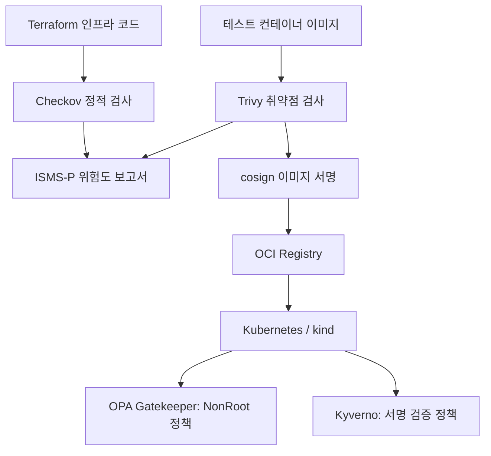

# AWS EKS Security Automation

**Terraform · GitHub Actions · Checkov · Trivy · OPA Gatekeeper · Rego · Sigstore/cosign · Kyverno · ISMS-P**

AWS EKS 환경을 대상으로 **인프라 코드, 컨테이너 이미지, Kubernetes 배포 요청**에 보안 검사를 적용하는 프로젝트입니다. 각 보안 정책을 코드로 관리하고, 검사 결과를 ISMS-P 통제항목 및 위험도 보고서와 연계하여 문제를 발견하고 조치할 수 있도록 구성했습니다.

> **검증 범위 (2026-11-08)**
> 주요 보안 기능은 **로컬 kind 클러스터에서 구현·검증**했습니다. 실제 AWS EKS 클러스터는 비용을 고려하여 **아직 생성하거나 배포 검증하지 않았습니다**. Checkov 위반 12건의 조치·예외 검토 등 남은 과제는 아래에 별도로 기록했습니다.

## 프로젝트 목표

- **Shift Left:** Terraform 및 컨테이너 이미지의 보안 문제를 배포 전에 발견합니다.
- **Policy as Code:** Gatekeeper와 Kyverno로 Kubernetes 생성 요청에 보안 정책을 적용합니다.
- **Software Supply Chain Security:** 이미지 Digest 서명과 공개키 검증을 배포 정책에 연결합니다.
- **위험 기반 관리:** Checkov·Trivy 결과를 ISMS-P 통제항목, 위험등급, 조치 검토 문서로 연결합니다.
- **검증 가능성:** 성공 사례뿐 아니라 실패 원인, 예외 범위, 아직 검증하지 않은 부분까지 기록합니다.

## 보안 검증 흐름



Checkov와 Trivy는 GitHub Actions 검사 워크플로가 있으며, **cosign 서명 자동화는 현재 로컬 스크립트 기반**입니다. 이 다이어그램은 보안 검증의 논리적 흐름을 나타내며, 모든 단계를 하나의 CI/CD 파이프라인으로 통합했다는 뜻은 아닙니다.

## 기술 스택 및 저장소 구성

| 구분 | 기술 | 용도 |
|---|---|---|
| 인프라 | Terraform, AWS VPC/EKS/IAM/ECR | AWS 배포 대상 구성 정의 |
| IaC 보안 | Checkov, GitHub Actions | Terraform 보안 규칙 검사 |
| 이미지 보안 | Trivy, GitHub Actions | HIGH/CRITICAL 취약점 검사 |
| Kubernetes 정책 | OPA Gatekeeper, Rego | Root 권한 실행 제한·예외 실습 |
| 이미지 공급망 보안 | Sigstore/cosign, Kyverno | 이미지 서명 및 배포 요청 검증 |
| 위험 관리 | ISMS-P 매핑, Python | 위험등급 산출 및 Markdown 보고서 생성 |
| 로컬 검증 | Windows 11, WSL Ubuntu, Docker Desktop, kind | AWS 비용 없이 기능 검증 |

검증 당시 주요 버전: Kubernetes `v1.35.0`, Checkov `3.3.29`, Trivy `0.76.1`, cosign `v3.1.4`, Kyverno `v1.19.1` (Helm Chart `3.9.1`).

```text
.
├── .checkov.yaml
├── .github/workflows/
│   ├── checkov.yml
│   └── trivy.yml
├── infra/                              # Terraform 코드
├── containers/test/                    # 테스트 이미지 빌드 컨텍스트
├── policies/
│   ├── gatekeeper/                     # Rego / ConstraintTemplate / Constraint
│   └── kyverno/
│       └── verify-local-cosign.yaml   # 로컬 이미지 서명 검증 정책
├── scripts/
│   ├── 07-isms-p-risk-report.py
│   └── 08-local-cosign-sign.sh
├── docs/                               # 보안 검사 및 실습 검증 문서
└── README.md
```

위 트리는 이 문서에서 다루는 **보안 자동화 관련 주요 경로만** 표시합니다. 저장소의 다른 구성요소는 생략했습니다.

---

## 1. ISMS-P 통제항목 매핑 및 Checkov 룰셋

### 구현 목적

Terraform 코드에서 발견한 보안 문제를 단순한 도구 경고로 끝내지 않고, 프로젝트에서 정의한 **ISMS-P 통제항목 및 후속 조치 대상**에 연결합니다.

### 구현 방식

- `.checkov.yaml`을 통해 Terraform 정적 검사 옵션을 일관되게 관리합니다.
- `soft-fail: false`를 사용하여 보안 위반이 발견되면 검사 단계가 실패하도록 구성했습니다.
- 실패한 Checkov 규칙 ID를 프로젝트 내부 ISMS-P 매핑 기준과 연결해 보고서에 기록합니다.

**관련 파일:** [Checkov 설정](.checkov.yaml), [ISMS-P / Checkov 매핑 보고서](docs/isms-p-checkov-report.md)

> 통제항목 매핑과 위험등급은 프로젝트 내부에서 설정한 평가 기준입니다. 공식 ISMS-P 인증 심사 또는 운영환경 적합성 판정 결과가 아닙니다.

## 2. Terraform IaC 정적 보안 검사 자동화

### 구현 목적과 검사 대상

AWS 자원을 생성하기 전에 Terraform 설정을 검사합니다. VPC·서브넷의 네트워크 접근, EKS API 접근 범위, 로그 수집·보존, 암호화, ECR 및 보안 그룹과 관련된 항목을 분석합니다.

### 실행 방법

사전 조건: Python 가상환경 등에서 Checkov가 설치되어 있어야 합니다. 이 명령어는 AWS 자원을 생성하지 않습니다.

```bash
mkdir -p reports
checkov --config-file .checkov.yaml \
  --var-file infra/terraform.tfvars.example \
  -o json > reports/checkov.json
```

GitHub Actions 검사 구성은 [`.github/workflows/checkov.yml`](.github/workflows/checkov.yml)에서 확인할 수 있습니다. 현재 보안 위반이 남아 있어 Checkov 검사의 **실행은 정상이어도 CI 결과는 실패할 수 있습니다**.

### 검증 결과

| 항목 | 건수 |
|---|---:|
| 전체 검사 | 49 |
| 통과 | 37 |
| 실패 | **12** |
| 실패 규칙 종류 | 11 |

실패 항목에는 퍼블릭 서브넷, EKS 퍼블릭 엔드포인트, CloudWatch 로그 보존·암호화, VPC Flow Logs 및 기본 보안 그룹 설정 등이 포함됩니다. **12건은 아직 수정하거나 예외 승인한 상태가 아닙니다.**

**관련 문서:** [Checkov 실패 항목 조치·예외 검토](docs/checkov-findings-review.md)

## 3. OPA Gatekeeper 설치 및 제약 조건 정의

### 구현 목적

Kubernetes API 서버가 Pod 생성 요청을 수락하기 전에 보안 정책 위반 여부를 검사합니다.

### 정책 구성

- **ConstraintTemplate:** Rego로 실제 판단 로직을 정의합니다.
- **Constraint:** 정책을 적용할 대상과 위반 시 거부(`deny`) 동작을 지정합니다.
- 로컬 `kind-team4`에서 Gatekeeper Controller와 Audit 구성요소 실행을 확인했습니다.

**관련 파일:** [`policies/gatekeeper/nonroot-template.yaml`](policies/gatekeeper/nonroot-template.yaml), [`policies/gatekeeper/nonroot-constraint.yaml`](policies/gatekeeper/nonroot-constraint.yaml)

기존 로컬 실습 클러스터가 있을 때 정책 상태를 확인하는 명령어입니다.

```bash
kubectl --context kind-team4 get pods -n gatekeeper-system
kubectl --context kind-team4 get team4nonroot son-require-nonroot
```

## 4. Root 권한 실행 방지 Rego 정책

### 구현 목적 및 정책 동작

Pod의 `securityContext`에서 실행 사용자 설정을 검사하여 Root 권한 사용을 제한합니다. Pod·컨테이너 설정을 함께 고려하도록 구현했습니다.

| 설정 | 서버 측 Dry Run 결과 |
|---|---|
| `runAsUser: 0` | 거부 |
| `runAsUser: 1000` | 허용 |
| `runAsNonRoot: true` (UID 미지정) | 허용 |
| 실행 사용자 관련 설정 없음 | 거부 |

검증은 **Kubernetes 서버 측 Dry Run의 Admission 결정**을 대상으로 진행했습니다. 허용된 Pod가 실제 환경에서 항상 정상 실행되거나 다른 보안 문제가 없다는 뜻은 아닙니다.

## 5. ISMS-P 위험도 평가 보고서 자동화

### 구현 목적과 입력

Python 스크립트가 Checkov의 실패 항목과 Trivy의 HIGH/CRITICAL 분석 결과를 읽어, 통제항목·위험등급·개선 검토 내용을 Markdown 보고서로 생성합니다.

- 입력: `reports/checkov.json`, `reports/trivy.json` (존재하는 경우)
- 처리: Checkov 규칙 ID 매핑, 발생 가능성 × 영향도 기반 초기 위험점수 산정, 위험등급 분류
- 출력: `reports/isms-p-risk-report.md`

```bash
python3 scripts/07-isms-p-risk-report.py
```

### 검증 결과

| 초기 위험등급 | 건수 |
|---|---:|
| 상 | 4 |
| 중 | 6 |
| 하 | 2 |
| **합계** | **12** |

이 등급은 **프로젝트 내부 초기 평가**입니다. 실제 운영환경에서는 자산 중요도·접근 범위·보완통제·업무 영향을 반영하여 재평가해야 합니다.

**관련 파일:** [`scripts/07-isms-p-risk-report.py`](scripts/07-isms-p-risk-report.py), [위험도 보고서](docs/isms-p-risk-report.md)

## 6. Gatekeeper 오탐 분석 및 예외 정책

### 발견한 문제와 개선

초기 정책은 `runAsUser`가 없다는 이유만으로 UID 0 사용으로 판단해, `runAsNonRoot: true`만 지정한 정상 요청도 차단했습니다. 이를 개선해 **명시적인 UID 0은 차단하면서 UID가 미지정된 경우 `runAsNonRoot: true`는 허용**하도록 수정했습니다.

### Namespace 예외 검증

- `son-policy-test`: Root 실행 요청 거부
- `son-policy-exception`: 실습 목적으로 **해당 NonRoot Constraint만** 적용 대상에서 제외

이 예외는 테스트용 설정이며, 클러스터의 모든 보안 정책을 비활성화하는 설정은 아닙니다. 운영 적용 시에는 예외 대상과 승인 근거를 별도로 관리해야 합니다. Gatekeeper 감사 상태에서 관측한 `K8sNativeValidation engine is missing` 메시지도 추가 점검 대상입니다.

**관련 문서:** [Gatekeeper NonRoot 검증](docs/gatekeeper-nonroot-validation.md)

## 7. Sigstore/cosign 이미지 서명

### 구현 목적

컨테이너 이미지 Digest를 개인키로 서명하고, 공개키로 서명과 이미지의 일치 여부를 확인합니다. **서명 검증은 이미지 취약점 검사를 대신하지 않습니다.**

### 로컬 자동화 과정

1. Trivy로 HIGH/CRITICAL 취약점 검사
2. 테스트 이미지를 로컬 OCI Registry에 Push
3. 이미지 Digest 확인 및 cosign 서명
4. 공개키로 서명 검증

`scripts/08-local-cosign-sign.sh`에서 위 절차를 실행하며, Trivy 보안 게이트에 실패하면 후속 서명 단계로 진행하지 않도록 구성했습니다.

```bash
# 사전 준비: Docker, 테스트 이미지, Registry, cosign 키·설정
./scripts/08-local-cosign-sign.sh
```

### 검증 결과

서명 이미지의 공개키 검증이 성공했고, 미서명 이미지는 `no signatures found`로 예상대로 실패했습니다. 개인키는 Git 저장소 외부에서 관리하며 **절대 커밋하지 않습니다**.

**현재 범위:** 로컬 스크립트를 이용한 서명·검증을 완료했습니다. GitHub Actions에 cosign 자동 서명 단계를 구현한 것은 아닙니다.

**관련 문서:** [cosign 서명 검증](docs/cosign-signing-validation.md)

## 8. 컨테이너 이미지 취약점 검사 — Trivy

### 구현 목적 및 방식

Trivy를 통해 컨테이너 이미지의 알려진 HIGH/CRITICAL 취약점을 검사합니다. 로컬 결과는 ISMS-P 보고서의 입력으로 사용할 수 있고, GitHub Actions의 검사 게이트는 위반이 발견되면 실패하도록 설정했습니다.

```bash
docker build --build-arg BASE_IMAGE=alpine:3.22 \
  -t team4-test:ci ./containers/test

# 보고서 입력 생성용: --exit-code 0 (CI의 차단 동작과 다름)
trivy image --scanners vuln --severity HIGH,CRITICAL \
  --exit-code 0 --format json \
  --output reports/trivy.json team4-test:ci
```

Alpine 3.22 기반 **해당 테스트 이미지**의 검증 시점에서 HIGH/CRITICAL **0건**을 확인했고, Trivy GitHub Actions 실행도 성공했습니다. 이는 모든 이미지의 안전성을 보장하지 않습니다.

**관련 파일:** [Trivy GitHub Actions](.github/workflows/trivy.yml)

## 9. Kyverno 이미지 서명 검증 정책

### 구현 목적과 정책 범위

Kyverno의 `NamespacedImageValidatingPolicy`를 사용해, **cosign 공개키로 서명을 확인할 수 있는 이미지의 Pod 생성 요청만 허용**합니다.

- 정책 Namespace: `son-kyverno-sign-test`
- 정책 이름: `require-team4-cosign`
- 이미지 대상: `team4-registry:5000/team4-*`
- 미서명 또는 검증 실패 이미지: 생성 요청 거부

### 로컬 검증 결과

| 검증 항목 | 결과 |
|---|---|
| Kyverno v1.19.1 설치 및 컨트롤러 기동 | 성공 |
| 정책 적용 후 `READY=true` | 확인 |
| 서명된 `team4-test:ci` 서버 측 Dry Run | 생성 요청 허용 |
| 미서명 `team4-unsigned:ci` 서버 측 Dry Run | 정책에 의해 거부 |
| 서명된 이미지의 실제 Pod 실행 | 검증 당시 `signed-runtime-test-v2` **`1/1 Running`** |

### 문제 해결 이력

- cosign 3에서 생성된 기본 서명을 Kyverno가 찾지 못해, 기존 방식의 `.sig` 태그 서명을 추가한 뒤 검증했습니다.
- kind 노드의 containerd가 HTTP Registry에 HTTPS로 접속하여 `ImagePullBackOff`가 발생했습니다. 로컬 노드의 Registry 설정을 수정한 후 이미지 Pull 및 실제 Pod 실행을 확인했습니다.

위 Registry 설정은 **로컬 실습용이며 클러스터 재생성 시 다시 설정해야 할 수 있습니다**. 실제 EKS에서 HTTP Registry를 그대로 사용하는 것을 권장하지 않습니다.

**관련 파일:** [Kyverno 정책](policies/kyverno/verify-local-cosign.yaml), [Kyverno 검증 보고서](docs/kyverno-signing-validation.md)

---

## 10. 로컬 검증 환경 및 재현

### 사전 요구사항

- WSL Ubuntu 또는 Linux, Docker / Docker Desktop
- Python 3, Terraform, Checkov, Trivy
- 정책 실습용 `kubectl`, `kind`, `helm`
- 이미지 서명 실습용 `cosign`, OCI Registry 및 자체 테스트 키

아래 명령어는 도구와 **기존 `kind-team4` 실습 클러스터가 준비된 상태**를 가정합니다. 클러스터나 AWS 인프라를 자동 생성하지 않습니다.

```bash
# 클러스터 및 정책 상태 확인
kubectl --context kind-team4 get nodes
kubectl --context kind-team4 get pods -n gatekeeper-system
kubectl --context kind-team4 get pods -n kyverno
kubectl --context kind-team4 get namespacedimagevalidatingpolicy \
  -n son-kyverno-sign-test

# 검사 결과 생성 및 위험도 보고서 작성
mkdir -p reports
checkov --config-file .checkov.yaml \
  --var-file infra/terraform.tfvars.example \
  -o json > reports/checkov.json
# Checkov에서 위반이 발견되면 종료 코드 1이 발생할 수 있음
python3 scripts/07-isms-p-risk-report.py
```

> **재현 범위:** 위 내용은 기존 실습 클러스터의 확인 및 로컬 검사 예시입니다. 새 환경에서 Gatekeeper·Kyverno·Registry·개인키를 자동으로 설치하는 완전한 원클릭 설치 절차는 아닙니다. cosign 키와 Registry 주소는 환경에 맞게 준비해야 합니다.

## 11. 확인된 한계 및 보안 주의사항

- **실제 AWS EKS 환경에서는 아직 배포·검증하지 않았습니다.** Terraform 코드 존재만으로 AWS 배포 완료를 의미하지 않습니다.
- **Checkov 위반 12건은 미해결 상태**로 조치 또는 공식적인 예외 검토가 필요합니다.
- Gatekeeper 정책은 로컬 Admission Dry Run 기반 결과가 중심이며, 감사 메시지 원인 점검이 남아 있습니다.
- Kyverno 서명 정책은 지정된 **테스트 Namespace와 이미지 참조 패턴**에만 적용됩니다. 모든 워크로드를 보호하는 정책은 아닙니다.
- 로컬 Registry는 HTTP이며, 실습 중 투명성 로그 검증을 생략했습니다. 운영환경에서는 HTTPS Registry, 검증 가능한 신뢰 체계, 안전한 키 관리가 필요합니다.
- `reports/`의 로컬 검사 산출물, 비밀번호, 개인키, 토큰 및 실사용 자격증명을 공개 저장소에 커밋하지 않아야 합니다.

## 12. 향후 개선 계획

- [ ] Checkov 실패 항목 12건의 개선 및 예외 승인 기준 확정
- [ ] Gatekeeper Audit 상태 메시지의 원인 분석
- [ ] cosign 서명 단계를 CI에 안전하게 연동
- [ ] Kyverno 정책을 운영형 Registry·이미지·키 관리 구성에 맞게 일반화
- [ ] 네트워크 격리 및 시크릿 주입 통합 검증
- [ ] AWS EKS 배포 후 보안 정책 및 위험도 재검증

## 13. 관련 문서

| 문서 | 설명 |
|---|---|
| [ISMS-P / Checkov 매핑](docs/isms-p-checkov-report.md) | Terraform 검사와 내부 통제항목 매핑 |
| [Checkov 실패 12건 검토](docs/checkov-findings-review.md) | 미해결 보안 설정의 조치·예외 검토 |
| [ISMS-P 위험도 보고서](docs/isms-p-risk-report.md) | Checkov·Trivy 결과 및 초기 위험도 |
| [Gatekeeper 정책 검증](docs/gatekeeper-nonroot-validation.md) | Root 권한 차단 및 예외 적용 검증 |
| [cosign 서명 검증](docs/cosign-signing-validation.md) | 이미지 서명·검증 및 로컬 자동화 |
| [Kyverno 서명 검증](docs/kyverno-signing-validation.md) | 서명 이미지 허용·미서명 이미지 차단과 문제 해결 |

---

이 저장소는 보안 정책과 자동화 구현의 **재현 가능한 검증 과정**을 공유하기 위한 프로젝트입니다. 로컬 kind 실습 결과와 AWS EKS 실환경 검증 결과를 구분하여 기록합니다.
