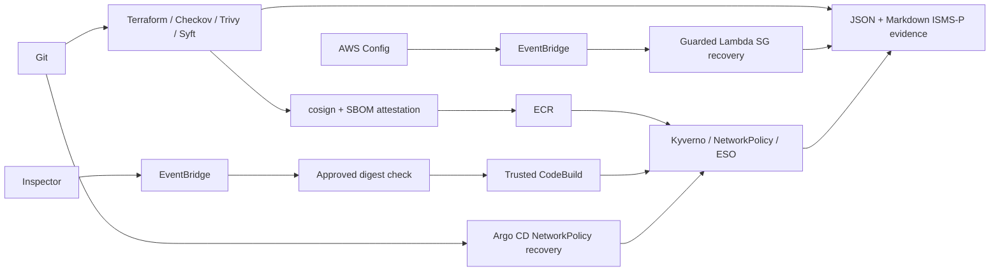

# AWS EKS DevSecOps + ISMS-P Self-Healing

BusyBox HTTP 테스트 프로그램을 사용해 이미지 검사·서명, Kubernetes 접근통제, AWS 설정 자동복구와 기술 통제 증적을 연결합니다. 실제 검증 범위는 [IMPLEMENTATION_STATUS.md](IMPLEMENTATION_STATUS.md)에 구분했습니다. AWS 실행 상태와 남은 조건은 [남은 작업](REMAINING_TASKS.md)을 따릅니다.



## 실행 환경과 설치

Windows PowerShell에서 Ubuntu WSL 및 Docker Desktop을 사용합니다. 아래 명령은 Ubuntu의 프로젝트 루트에서 실행합니다. 기존 `kind-team4`는 재사용하며 삭제하지 않습니다.

```bash
bash scripts/01-install-tools.sh  # 기존 기본 도구가 없는 Linux x86_64 환경에서만
bash scripts/bootstrap-python.sh
source .venv-ci/bin/activate
export PATH="$PWD/.tools/bin:$PATH"
bash scripts/install-security-tools.sh
```

## 로컬 실행과 검증

```bash
bash scripts/02-local-cluster.sh  # 기존 team4가 있으면 재생성하지 않음
bash scripts/image-security.sh
bash scripts/03-local-workloads.sh
bash scripts/08-network-policy-test.sh kind-team4
bash scripts/09-eso-test.sh kind-team4 fake
bash scripts/07-install-security-addons.sh kind-team4 kyverno
bash scripts/10-admission-test.sh kind-team4
bash scripts/local-signature-test.sh
bash scripts/test-vulnerability-gate.sh
bash infra/validate-local.sh
bash infra/scan-security.sh
python scripts/generate-project-reports.py
```

GitOps 설정과 실제 drift 시험은 [Kubernetes 실행 안내](docs/kubernetes-notes.md)를 따릅니다. 이 저장소는 deploy key를 금지하므로 직접 연결에는 승인된 읽기 전용 GitHub 인증이 필요합니다. 로컬 시험은 게시된 40자리 commit의 읽기 전용 내부 mirror를 사용할 수 있습니다. 로컬 cosign 키 검증과 AWS keyless admission 검증은 별개입니다.

bare BusyBox 원본은 APK/DPKG 목록이 없어 취약점 검사 범위가 비어 있었습니다. 현재 Dockerfile은 Alpine에서 제공하는 BusyBox httpd를 사용하며, 패키지 목록이 없는 스캔과 빈 SBOM을 실패시킵니다. 이미지 config digest, registry manifest digest, Docker image-store ID를 구분합니다.

## AWS 배포

현재 실행 조건: 승인된 신규 자원 67개 생성 및 EKS 1노드 Ready 확인. 실제 GitHub OIDC→ECR 서명·SBOM→EKS HTTP 배포, NetworkPolicy, ESO rotation, Kyverno 미서명 거부, Argo CD 정책 복구 통과. Config→EventBridge→Lambda 실제 SG 자동복구·정상 재평가 통과. 신규 실행 자원 삭제 후 조회 완료; KMS/Secret은 복구 기간을 둔 삭제 예약. 상태 확인: 2026-10-23T14:12:48.687037+00:00.

[실제 AWS 계획](docs/AWS_PLAN_REVIEW.md), [배포 가이드](AWS_DEPLOYMENT_GUIDE.md), [IAM 권한](docs/TEAM4_IAM_PERMISSIONS.md), [GitHub 설정](docs/GITHUB_SETUP.md), [비용·정리](COST_AND_CLEANUP.md)를 확인합니다. `team4` 프로필/계정 `852093844554`/서울 리전, 총예산 상한 180,000원입니다. 실제 plan을 검토하고 유료 생성 승인을 받은 뒤 배포합니다. 자동복구는 기본 DRY_RUN이며 운영 자원은 대상으로 삼지 않습니다.

CI는 PR에서 실행되고 AWS 배포는 보호된 `aws-demo` 환경의 main 전용 수동 workflow와 EKS에 접근 가능한 전용 runner에서 실행됩니다. NAT·ALB는 기본 구성에 없습니다. Inspector CodeBuild는 네트워크 경로가 준비된 별도 전용 프로젝트를 요구합니다.

## 문서·증적

- [보안 시험](SECURITY_TEST_REPORT.md), [자동복구](SELF_HEALING_REPORT.md), [ISMS-P 매핑](ISMSP_MAPPING_REPORT.md), [남은 작업](REMAINING_TASKS.md)
- [Terraform 설계와 Checkov 예외](docs/infra-notes.md), [자동복구 내부 계약](automation/README.md)
- 실제 JSON/명령 결과: `evidence/` (Git 제외). JSON 보고서: `evidence/reports/isms-p.json`.
- 기존 시작 안내서는 [docs/BOOTSTRAP_ORIGINAL.md](docs/BOOTSTRAP_ORIGINAL.md)에 보존했습니다. 현재 실행 절차는 이 README와 위 문서를 사용합니다.

기술 점검만으로 ISMS-P 전체 인증 충족 여부를 판단하지 않습니다. 로그·state·비밀키·AWS 자격증명을 Git에 올리지 않습니다.
