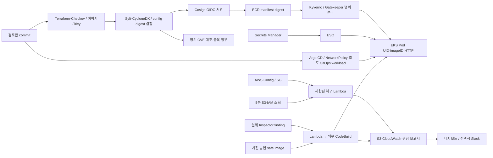

# AWS EKS 보안 통제와 자동복구 실습서

2026-11-16 최종 통합 준비판. 이 책의 제품은 별도 웹서비스가 아니라 **선정한 ISMS-P 기술 통제를 구현하고 검증하는 보안 실습 환경**이다. HTTP 응답 `team4 server ok`는 Pod 실행·네트워크·복구를 판정하기 위한 시험 대상이다.

실제 관측값은 [최신 검증 결과](../VALIDATION.md), 원본은 [이번 실행 증적](../evidence/finalization-20261116/), 구현/시험/담당 연결은 [WBS 검증 매핑](wbs/task-evidence.json)을 따른다. 이 책의 “예상” 출력은 설명용이다. AWS 절차는 이번 실행에서 **NOT_TESTED**이며 [새 실행 계획](AWS_EXECUTION_PLAN.md)의 승인 이후에만 진행한다. 과거 결과는 [이력](history/README.md)에 보존했다.

## 1. 범위와 구조

ISMS-P 전체 인증에는 조직·인적·물리적·개인정보 처리 등 이 저장소가 검증하지 않는 영역이 있다. 이 프로젝트는 접근 통제, 암호화, 보안 요구사항, 변경·취약점 관리, 로그와 사고 대응 중 일부 기술 증거를 만든다. [KISA 안내서](https://pims.kisa.or.kr/board/file/bbs_0000000000000014/21/FILE_000000000001002/202311231554317701147901071.pdf)를 기준으로 통제 연결의 적합성을 팀이 검토해야 한다. 자동 보고서를 인증 충족 판정으로 사용하지 않는다.



`commit`은 소스, `source_tree_sha256`은 미커밋 변경까지 포함한 파일 내용, image config digest는 이미지 구성, registry manifest digest는 레지스트리 배포 대상을 식별한다. 서로 다른 값을 같은 digest라고 부르지 않는다. 한 실행의 scan metadata, SBOM binding, 서명 검증, 배포 Pod 관측값을 연결한다. 최종 AWS 시연은 검토 commit 하나의 workflow 산출물을 사용한다.

## 2. 파일을 읽는 순서

| 위치 | 역할 |
|---|---|
| [infra/](../infra/) | 기존 VPC/EKS/ECR/IRSA/Secret/KMS와 선택적 자동복구·관측 자원 |
| [CI](../.github/workflows/checkov.yml) | 검사 1회 후 artifact를 보고서에 전달. 실패해도 보고서 작성은 시도하되 gate 실패는 유지 |
| [배포 workflow](../.github/workflows/deploy.yml) | 승인 환경·main·전용 runner·OIDC 서명·실제 배포 검증 |
| [image-security.sh](../scripts/image-security.sh) | base digest 고정, 패키지 보안 갱신, 이미지 빌드, HTTP, Trivy, SBOM |
| [중앙 매핑](../policies/isms-p.json) / [위험 보고서](../scripts/07-isms-p-risk-report.py) | 도구 원본과 provenance를 읽고 통제·내부 위험 판단 연결 |
| [Gatekeeper](../policies/gatekeeper/) / [Kyverno](../policies/kyverno/) | non-root 비교 실험과 실제 demo 제한·서명 검증 |
| [SG 복구](../automation/sg_healing.py) / [S3·IAM 복구](../automation/resource_healing.py) | allowlist, dry-run, 변경 전후 조회, 실패 처리 |
| [Inspector worker](../automation/inspector_worker.py) | 실제 finding과 승인 이미지를 재검증하고 동시 변경 방지 패치·Pod HTTP 확인 |
| [SBOM 대조](../automation/sbom_watch.py) / [예약 workflow](../.github/workflows/sbom-watch.yml) | 기존 SBOM 재사용, 신규/반복/해결 항목 기록, HIGH/CRITICAL gate 유지 |
| [Slack](../automation/slack_notify.py) / [관측 Terraform](../infra/observability.tf) | 최소 필드 알림, 기본 전송 금지, 감사 로그·복구 상태 대시보드 |

## 3. 환경 준비와 증적 규칙

Windows 사용자는 Docker Desktop을 켜고 WSL Ubuntu 터미널에서 실행한다. 현재 PC의 저장소 위치는 다음과 같다. 다른 PC에서는 clone 경로를 바꾼다.

```bash
cd /mnt/d/Downloads/team4-startup-guide/team4-startup
git status --short
git branch --show-current
git log -1 --oneline
source .venv-ci/bin/activate
export PATH="$PWD/.tools/bin:$PATH"
export AWS_EC2_METADATA_DISABLED=true
RUN="evidence/rehearsal-$(date -u +%Y%m%dT%H%M%SZ)"
mkdir -p "$RUN"
python scripts/record-command.py --output-dir "$RUN/environment" -- docker version
kubectl --context kind-team4 get nodes
```

새 PC는 [Python 준비](../scripts/bootstrap-python.sh), [도구 설치](../scripts/01-install-tools.sh), [로컬 클러스터](../scripts/02-local-cluster.sh), [보안 도구 설치](../scripts/install-security-tools.sh)를 먼저 읽고 실행한다. 이미 검증한 클러스터를 이유 없이 지우고 만들지 않는다. 버전은 [보안 도구](../config/security-tools.env)와 [애드온](../config/security-versions.env), Terraform lockfile로 관리한다.

명령을 `record-command.py`로 감싸면 명령·시각·종료 코드·실행 전후 source hash와 원본 stdout/stderr가 남는다. `--kind MOCK`는 API 모의 시험, `LOCAL`은 실제 로컬 환경, `AWS_READ_ONLY`와 `AWS_LIVE`는 실제 AWS 범위를 뜻한다. Secret을 인수로 넘기거나 환경 전체를 덤프하는 명령은 기록기로 실행하지 않는다. raw Terraform state, kubeconfig, 개인키, `.env`, webhook은 Git에 넣지 않는다. 같은 output directory를 재사용하지 않는다.

검증 명령의 실패를 `|| true`로 지우지 않는다. 여러 실패를 수집할 때는 종료 코드를 별도 보존한 뒤 다음 독립 시험으로 진행한다. “실행 못 함”은 0건이 아니라 NOT_TESTED다. 화면 캡처가 없다면 실제 로그 링크만 사용한다.

## 4. 로컬 코드와 Terraform 검증

```bash
python scripts/record-command.py --kind MOCK --output-dir "$RUN/unit" -- \
  python -m unittest discover -s tests -v
python scripts/record-command.py --output-dir "$RUN/terraform-validate" -- \
  terraform -chdir=infra validate -no-color
python scripts/record-command.py --kind MOCK --output-dir "$RUN/terraform-mocks" -- \
  bash infra/test-isolated.sh
python scripts/record-command.py --output-dir "$RUN/workflow-lint" -- .tools/bin/actionlint
```

Terraform mock test는 실제 AWS 계정이나 자원을 사용하지 않는다. 새 기능 기본 off, Secret 값의 state 비저장, 보안 정책, archive 구성 등을 검증한다. 실제 API 권한·quota·리전 지원·네트워크는 AWS 단계에서 따로 확인한다. `terraform plan`과 `apply`는 서로 다르며, 이번 모의 plan의 성공을 AWS 배포 성공으로 기록하지 않는다.

## 5. 검사→이미지→SBOM→보고서

```bash
export SECURITY_RUN_ID="$(basename "$RUN")"
python scripts/security_scan.py --tool checkov --output "$RUN/checkov.json" \
  --target infra --stdout-json -- checkov --config-file .checkov.yaml --output json
# 위 명령이 실패하면 원본 결과를 검토한다. 실패를 무시한 배포는 금지.
EVIDENCE_DIR="$RUN/image" bash scripts/image-security.sh
python scripts/07-isms-p-risk-report.py --checkov "$RUN/checkov.json" \
  --trivy "$RUN/image/trivy.json" --output-dir "$RUN/risk" \
  --commit "$(git rev-parse HEAD)" --run-id "$SECURITY_RUN_ID"
```

Checkov가 실패해도 별도의 이미지 시험과 보고서 작성은 조사 목적으로 실행할 수 있다. 두 검사를 돌리는 사이에 소스를 수정하면 보고서는 출처 불일치를 표시한다. 보고서는 빌드나 검사를 다시 하지 않는다. CI는 동일 workflow의 결과 artifact를 받아 같은 commit/run을 검증한다.

이번 최초 이미지에서는 musl·musl-utils·zlib HIGH 3건과 zlib MEDIUM 1건이 발견됐다. 배포 게이트가 종료 1로 차단했다. Dockerfile에 APK 보안 갱신을 반영한 뒤 musl 1.2.5-r24, zlib 1.4-r0으로 갱신됐고 후속 검사에서 HIGH/CRITICAL 0건이었다. [Alpine musl](https://pkgs.alpinelinux.org/package/v3.23/main/x86_64/musl), [zlib 패키지](https://pkgs.alpinelinux.org/package/v3.23/main/x86_64/zlib)와 실제 build/scan 원본을 함께 확인한다. 새 로컬 이미지를 AWS의 “승인 safe image”로 자동 등록하지 않는다.

SBOM은 CycloneDX schema와 패키지 목록을 검증하고 config digest를 기록한다. ECR publish 후에는 manifest digest와 그 manifest의 config digest를 다시 연결한다. 파일만 존재하거나 syft가 종료 0이라는 이유로 결합 검증을 생략하지 않는다.

| 판단 | 의미 |
|---|---|
| Trivy Severity | 공급자 도구의 UNKNOWN/LOW/MEDIUM/HIGH/CRITICAL |
| 내부 위험 점수 | 팀 가정인 가능성 1~5 × 영향도 1~5. 15 이상 상, 8~14 중, 7 이하 하 |
| 이미지 배포 gate | package inventory·식별값·지원 OS 확인 및 HIGH/CRITICAL 차단 |
| Checkov gate | parsing error/실행 오류/failed check를 통과 처리하지 않음 |
| 보고서 종료 2 | 정상적으로 작성했지만 입력 누락·검사 생략·출처 미검증 등으로 INCOMPLETE |
| 보고서 종료 3 | PROGRAM_ERROR. 보고서 프로그램 자체 오류. 성공 보고서로 취급 금지 |
| 보고서 종료 1 / 0 | 완전한 범위에 발견 항목 있음 / 검사 범위 내 발견 없음. 전체 안전 인증 아님 |

23개 생략은 통과 수에 더하지 않는다. [예외 검토표](SECURITY_DISPOSITION.md)의 ACTION_REQUIRED, REVIEWED_EXCEPTION, UNRESOLVED는 처리 상태다. REVIEWED_EXCEPTION도 이번 실행의 승인이나 gate 면제를 뜻하지 않는다.

### AWS ECR·OIDC·실제 Pod로 이어가기

다음은 모든 검사 실패 처리와 [AWS 실행 승인](AWS_EXECUTION_PLAN.md) 이후 절차다. 검토 commit이 main에 반영되고, `aws-demo` 승인자·OIDC 역할·runner·EKS 정책 bootstrap이 준비되어야 한다. 통합 branch를 main에 자동 병합하지 않는다.

```bash
# 승인된 main commit에서만 수동 배포 workflow 실행
gh workflow run deploy.yml --repo realthoroughbred/capstone_1 --ref main
gh run list --repo realthoroughbred/capstone_1 --workflow deploy.yml --limit 3
read -r -p '이번 배포 run ID: ' DEPLOY_RUN_ID
gh run view "$DEPLOY_RUN_ID" --repo realthoroughbred/capstone_1 --exit-status
gh run download "$DEPLOY_RUN_ID" --repo realthoroughbred/capstone_1 \
  --name deployment-evidence --dir "$RUN/deployment-artifact"
APPROVED_ECR_IMAGE="$(cat "$RUN/deployment-artifact/deployed-image.txt")"
python scripts/verify-deployed-images.py --context team4-eks --image "$APPROVED_ECR_IMAGE" \
  --evidence "$RUN/pod-runtime-recheck.json"
kubectl --context team4-eks -n demo exec deployment/client -- \
  wget -T 5 -qO- http://server:8080
```

workflow 안에서 `publish-signed-image.sh`는 이미 검사한 archive/config/SBOM을 대조하고 ECR manifest, OIDC 서명, SBOM attestation을 검증한다. `deploy-verified-image.sh`는 그 immutable image를 적용하고 실제 server/client/unauthorized의 소유 Deployment·Pod imageID 및 HTTP를 검증한다. 성공 기준은 run head SHA 일치, schema/binding 검증, 서명 신원·issuer 일치, live Pod digest 일치, 정확한 HTTP 응답이다. 이번에는 이 AWS workflow를 실행하지 않았다. 검사·서명·rollout 실패는 해당 원본 결과를 보존하고 후속 배포를 중단한다.

## 6. Gatekeeper와 Kyverno의 책임 분리

Gatekeeper non-root 정책은 `son-policy-test`에만 적용한다. Kyverno restricted/read-only 및 AWS ECR 서명은 `demo`에 적용한다. 로컬 공개키·HTTP registry 서명은 `son-kyverno-sign-test`에만 적용한다. Gatekeeper의 결과에 Kyverno가 막은 요청을 합산하지 않는다.

```bash
GATEKEEPER_EVIDENCE_DIR="$RUN/gatekeeper-install" bash scripts/install-gatekeeper-local.sh
python scripts/record-command.py --output-dir "$RUN/gatekeeper-command" -- \
  python scripts/test-gatekeeper-local.py --output-dir "$RUN/gatekeeper" --image team4-test:v1
EVIDENCE_DIR="$RUN/fresh-crd" python scripts/record-command.py --output-dir "$RUN/fresh-crd-command" -- \
  bash scripts/test-gatekeeper-crd.sh
python scripts/record-command.py --output-dir "$RUN/signature-command" -- \
  python scripts/test-local-image-policy.py --archive "$RUN/image/image.tar" --output-dir "$RUN/signature"
```

Gatekeeper 설치는 template 생성 후 CRD 생성, Established, template created 상태를 순서대로 기다린다. controller 조회 실패/빈 상태/낡은 observedGeneration은 실패다. Pod 조회 실패를 “Pod 없음”으로 세지 않는다. 정상 생성→Ready→UID→실제 HTTP 검증과 server dry-run 결과를 별도 phase로 기록한다.

로컬 서명 시험은 임시 registry와 임시 키를 만들고 정상 서명·미서명·다른 키를 비교한다. 실제 Pod는 같은 digest로 실행한다. 종료 시 namespace/service/registry를 지우고 kind 노드 registry 설정을 원복한다. 테스트가 생성한 개인키는 증적에 남기지 않는다. 기존 동명 시험 자원이 있으면 덮어쓰지 않고 중단한다. 이 시험의 HTTP 허용·투명성 로그 생략 설정은 [AWS OIDC 정책](../policies/kyverno/ecr-signatures.yaml.template)에 복사하지 않는다.

AWS 설치는 승인 후 다음처럼 실행한다. `EXPECTED_API_SERVER`는 STS 계정과 EKS describe-cluster에서 확인한 endpoint다.

```bash
export APPROVE_AWS_TEST=true EXPECTED_ACCOUNT_ID="$ACCOUNT" AWS_REGION=ap-northeast-2
bash scripts/install-gatekeeper-eks.sh
python scripts/test-gatekeeper-local.py --context team4-eks --approved-aws-test \
  --expected-api-server "$EXPECTED_API_SERVER" --image "$APPROVED_ECR_IMAGE" \
  --output-dir "$RUN/gatekeeper-eks"
```

AWS 결과의 성공 기준은 webhook Ready, 정상 대조군 허용, root/init/ephemeral 위반에 Gatekeeper 이름이 포함된 거부, 거부 Pod 부재, 실제 허용 Pod 실행이다. 설치 권한 부족·CRD 대기 timeout은 NOT_TESTED/FAIL로 남긴다. 정리는 해당 테스트 Pod/namespace부터 진행하고 공유 webhook을 임의로 삭제하지 않는다.

## 7. 네트워크 통제

선행조건은 Calico가 있는 kind 또는 NetworkPolicy를 지원하는 EKS CNI, demo server/client/unauthorized Deployment다.

```bash
EVIDENCE_DIR="$RUN/network" bash scripts/08-network-policy-test.sh kind-team4
```

시험은 DNS 및 정상 client의 HTTP를 먼저 확인한다. 비인가 Pod의 요청이 3회 연속 막혀야 한다. 이어 임시로 ingress만 허용하면 egress가 계속 막고, 두 방향을 모두 허용하면 같은 출발지/목적지가 연결되고, ingress 허용을 제거하면 다시 차단되는지 본다. 정상 대조군의 exec/DNS가 실패한 경우를 보안 차단 성공이라고 해석하지 않는다. 임시 정책은 finally에서 제거하고 기본 deny 정책은 유지한다.

이번 로컬 시험은 실제 통신으로 통과했다. AWS에서는 승인 후 context만 `team4-eks`로 바꾸고 동일 시험을 새 증적 폴더에 실행한다. 원본 로그와 NetworkPolicy JSON이 증거다.

## 8. Secret 값 갱신과 KMS 순환

```bash
# 실제 로컬 fake provider → K8s Secret → 이미 실행 중인 Pod의 volume
EVIDENCE_DIR="$RUN/eso-local" bash scripts/09-eso-test.sh kind-team4 fake
```

Secret 값은 출력하지 않는다. Kubernetes Secret과 Pod 마운트 파일의 해시가 일치하는지 비교하고, 새 난수 값으로 갱신한 뒤 기존 값과 달라지면서 두 위치가 다시 일치해야 한다. 환경변수로 주입된 Secret은 기존 프로세스에 자동 갱신되지 않으므로 이 시연은 **mounted volume**을 사용한다. 기존 원본 SecretStore가 아닌 전용 fake provider만 바꾼다.

AWS는 승인 후 [EKS 보안 설정](../scripts/12-configure-eks-security.sh)으로 IRSA/ESO를 적용하고 Terraform output의 전용 demo Secret ARN을 사용한다.

```bash
export ESO_ROLE_ARN="$(terraform -chdir=infra output -raw eso_role_arn)"
export DEMO_SECRET_ARN="$(terraform -chdir=infra output -raw demo_secret_arn)"
EVIDENCE_DIR="$RUN/eso-aws" bash scripts/09-eso-test.sh team4-eks aws --rotate-demo
aws secretsmanager describe-secret --secret-id "$DEMO_SECRET_ARN" \
  --query '{ARN:ARN,LastChangedDate:LastChangedDate,VersionIdsToStages:VersionIdsToStages}' > "$RUN/secret-metadata.json"
```

이 명령은 실제 Secret 값을 변경하므로 별도 승인 범위다. 성공 기준은 Secrets Manager 새 version, ESO Ready, Kubernetes Secret과 기존 Pod volume의 새 해시 일치다. 실패 시 IRSA trust/aud/sub, Secret ARN, KMS ViaService 조건, ESO event를 확인하되 Secret data를 덤프하지 않는다.

KMS rotation은 암호화 키 재료의 순환이다. Secret 값을 바꾸는 것과 다르며 기존 ciphertext를 자동 재암호화하지 않는다. [AWS KMS 문서](https://docs.aws.amazon.com/kms/latest/developerguide/rotate-keys.html)를 따른다.

```bash
# 읽기 검증. ARN은 이번 Terraform state와 AWS describe-key로 대조한 키만 사용
aws kms describe-key --key-id "$KMS_KEY_ARN" > "$RUN/kms-key-metadata.json"
aws kms get-key-rotation-status --key-id "$KMS_KEY_ARN" > "$RUN/kms-rotation-status.json"
aws kms list-key-rotations --key-id "$KMS_KEY_ARN" > "$RUN/kms-rotation-history.json"
```

`KeyRotationEnabled=true`는 자동 순환 설정의 증거일 뿐 이번 4시간에 키가 실제 순환했다는 증거가 아니다. on-demand 순환은 추가 비용과 승인 대상이며 이번에는 실행하지 않았다. 실제 순환을 시연하려면 별도 승인 후 `aws kms rotate-key-on-demand --key-id "$KMS_KEY_ARN"`를 실행하고 이력의 완료·기존 데이터 복호화·새 데이터 암호화를 비교한다. 키 삭제는 복구 기능이 아니며 실험 중 실행하지 않는다.

## 9. GitHub 직접 인증과 GitOps 복원

이번 로컬 Argo의 실제 소스는 내부 Git mirror와 과거 pinned commit이다. drift 복원 성공을 GitHub 직접 인증 성공으로 부르지 않는다. Deploy Key HTTP 422 차단 원본을 보존했다. 조직 관리자는 읽기 전용 GitHub App을 해당 저장소 하나에 설치한다.

```bash
# 키 파일은 Git 밖에 저장. 이 명령은 키/토큰을 출력하지 않는다.
python scripts/configure-gitops-app-auth.py --context kind-team4 \
  --app-id "$GITHUB_APP_ID" --installation-id "$GITHUB_INSTALLATION_ID" \
  --private-key-file "$GITHUB_APP_KEY_FILE" --inspect-only
python scripts/configure-gitops-app-auth.py --context kind-team4 \
  --app-id "$GITHUB_APP_ID" --installation-id "$GITHUB_INSTALLATION_ID" \
  --private-key-file "$GITHUB_APP_KEY_FILE"
export GITOPS_REPO_URL=https://github.com/realthoroughbred/capstone_1.git
export GITOPS_REVISION="$(git rev-parse HEAD)" # 반드시 원격에 존재하는 검토 commit
EVIDENCE_DIR="$RUN/gitops" bash scripts/11-gitops-drift-test.sh kind-team4
```

시험은 Synced 기준 spec 확보→자동 복원 일시 정지→ingress 제거가 실제 허용되는지 확인→OutOfSync와 통신 실패 관찰→selfHeal 재개→새 성공 operation 및 Git spec 일치→HTTP 정상 순서다. 스크립트가 NetworkPolicy를 직접 원복해서 Argo 성공처럼 보이게 만들지 않는다. 실패하더라도 원래 selfHeal 설정은 복구한다.

WBS의 GitOps 배포 범위를 위해 별도의 `gitops-server` Deployment/Service/NetworkPolicy 렌더러와 AppProject를 추가했다. Inspector가 교체하는 `server`와 소유권 충돌을 피한다.

```bash
python scripts/prepare-gitops-workloads.py --image "$APPROVED_ECR_IMAGE" \
  --build-commit "$APPROVED_BUILD_COMMIT"
# 생성 manifest 검토·commit·push 후 해당 commit을 Application targetRevision으로 사용
export GITOPS_REPO_URL GITOPS_REVISION
python scripts/render-template.py k8s/gitops/workloads-application.yaml.template > "$RUN/gitops-workloads-application.yaml"
kubectl --context team4-eks apply -f "$RUN/gitops-workloads-application.yaml"
kubectl --context team4-eks -n demo rollout status deployment/gitops-server --timeout=180s
```

위 AWS apply는 승인 이후다. 승인 이미지와 GitHub App이 아직 없어 실제 GitHub workload sync는 NOT_TESTED다. 생성 전의 template만으로 WBS를 완료 처리하지 않는다.

## 10. SG·S3·IAM 위반과 제한된 복구

모든 신규 복구는 기본 off/dry-run이다. 대상 계정·리전·태그·정확한 ARN을 확인한다. 권한 부족, 다른 리소스, 중복 이벤트, 실패·재시도를 단위 시험으로 검증한다. AWS 서비스가 전달한 실제 이벤트와 fixture 모의 이벤트를 별도 기록한다.

SG 기존 보호 조건은 유지한다. DemoOnly, 정확한 SG ID, ENI 미연결, Config 실제 NON_COMPLIANT, 이벤트 freshness·계정·리전 확인 후 해당 공개 SSH 규칙만 제거하고 재조회한다.

```bash
# 승인 후: 다른 SG 대신 Terraform output의 전용 시험 SG만 사용
python scripts/13-sg-healing-demo.py --account "$ACCOUNT" --region "$AWS_REGION" \
  --security-group-id "$DEMO_SG_ID" --function-name "$SG_FUNCTION" \
  --config-rule "$SG_CONFIG_RULE" --approved-demo --timeout-seconds 900 \
  --evidence "$RUN/sg-real-event.json"
```

성공은 주입한 규칙 삭제뿐 아니라 실제 Config NON_COMPLIANT, 해당 Lambda 복구 로그, 새 COMPLIANT 재평가까지다. timeout/CloudWatch 조회 실패는 실패다. 자체 시험 규칙의 정리 결과도 기록한다.

S3/IAM은 현재 **5분 주기 실제 AWS 조회** 방식이다. Config 즉시 이벤트 기반이라고 설명하지 않는다. S3는 전용 비어 있는 버킷의 PublicAccessBlock 4개만 복구한다. 객체·버전·delete marker가 있거나 태그가 다르면 거부한다. IAM은 assume-role trust가 전면 Deny이고 managed policy가 없으며 inline policy 이름이 정확히 `sandbox-deny-all`인 role만 복구한다. 로그인 사용자·키·일반 운영 role은 건드리지 않는다.

승인 후 시험자는 `get-bucket-tagging`, `list-object-versions`, `get-public-access-block`, `get-role`, `list-attached-role-policies`, `list-role-policies`, `get-role-policy`의 before 상태를 저장한다. 함수의 allowlist와 일치하지 않으면 중단한다. 버킷의 네 가지 차단 중 **BlockPublicAcls 하나만 false**로 바꾸되 나머지 3개와 계정 차단은 유지한다. IAM은 미리 승인한 deny-all 정책에서 Action만 `s3:*`로 축소하여 정책 drift를 만들되 trust의 전면 Deny는 유지한다. 실제 전송할 JSON을 사용자가 먼저 검토한다.

```bash
# 실제 위반 주입: 비용·대상·범위를 승인받고 before 사전조건 확인 후에만 실행
aws s3api put-public-access-block --bucket "$SANDBOX_BUCKET" --expected-bucket-owner "$ACCOUNT" \
  --public-access-block-configuration BlockPublicAcls=false,IgnorePublicAcls=true,BlockPublicPolicy=true,RestrictPublicBuckets=true
aws iam put-role-policy --role-name team4-healing-sandbox --policy-name sandbox-deny-all \
  --policy-document '{"Version":"2012-10-17","Statement":[{"Effect":"Deny","Action":"s3:*","Resource":"*"}]}'
```

다음 scheduled event를 기다린 뒤 로그의 `event_origin`, event ID, before/after hash, `REMEDIATED`를 AWS 재조회 결과와 대조한다. 결과는 `evidence_bucket`의 S3에도 저장된다. 수동 Lambda invoke는 실제 정기 탐지 성공과 별도로 기록한다.

복구 실패 시 S3의 4개 PublicAccessBlock을 모두 true로 되돌리고 IAM은 `{"Version":"2012-10-17","Statement":[{"Effect":"Deny","Action":"*","Resource":"*"}]}`로 원복한 뒤 재조회한다. 원복 자체 실패는 FAILED이며 다음 시험을 중단한다. 직접 정리한 경우 자동복구 성공으로 기록하지 않는다. 현재 실제 S3/IAM 주입·복구는 NOT_TESTED다.

## 11. Inspector→CodeBuild→사전 승인 이미지

안전 이미지는 사람이 미리 준비·검사·서명·승인한다. [Inspector 대응](../automation/inspector_response.py)은 정확한 repository/digest의 ACTIVE HIGH/CRITICAL finding을 다시 조회하고 외부 CodeBuild를 호출한다. worker는 승인 SSM parameter의 digest, ECR manifest/config, Trivy 전체 package 결과, Cosign OIDC를 검증한 뒤 resourceVersion/test 조건이 있는 patch를 적용한다. 교체 후 deployment가 소유한 Pod UID·imageID와 service HTTP를 확인한다. 아무 이미지나 자동 빌드해 안전해졌다고 가정하지 않는다.

```bash
# 승인 후 읽기 증거: 실제 finding 존재 여부
aws inspector2 list-findings --filter-criteria file://"$RUN/approved-inspector-filter.json" \
  > "$RUN/inspector-findings.json"
aws ssm get-parameter --name /team4/security/approved-image \
  --query 'Parameter.{Name:Name,Version:Version,Value:Value}' > "$RUN/approved-image.json"
aws codebuild batch-get-projects --names "$CODEBUILD_PROJECT" > "$RUN/codebuild-project.json"
```

필터 파일은 `awsAccountId`, `ecrImageRepositoryName`, `ecrImageHash`의 EQUALS 값으로 이번 이미지만 지정한다. SSM Value는 승인 image URI이며 Secret으로 사용하지 않는다. 외부 프로젝트에 평문 환경변수 Secret이 없는지 확인한 뒤 프로젝트 JSON을 증적으로 저장한다. 실제 Inspector 이벤트와 CodeBuild build ID, 종료 상태, [worker 결과](../automation/inspector_worker.py), 배포 후 Pod 관측을 연결한다.

정상 대조군은 finding 없는 digest, 거부 대조군은 잘못된 account/repository, 만료 finding, 승인 이미지 없음, 서명 실패, fresh HIGH/CRITICAL, ECR/Trivy config 불일치, rollout/HTTP 실패다. 이 경우 기존 정상 deployment를 임의의 이미지로 교체하지 않는다. API mock 시험은 수행했지만 실제 Inspector finding→AWS 교체는 NOT_TESTED다. 복구 실패 때는 실패 queue를 확인하고 기존 검토된 deployment digest로 되돌릴지 사람이 판단한다.

## 12. SBOM 정기 CVE 대조

```bash
python scripts/sbom-watch.py --sbom "$RUN/image/sbom.cdx.json" \
  --binding "$RUN/image/sbom-link.json" --artifact-commit "$APPROVED_BUILD_COMMIT" \
  --state "$RUN/cve-ledger.json" --output-dir "$RUN/cve-first"
```

이미지를 다시 빌드하지 않고 해당 digest에 결합된 SBOM을 최신 Trivy DB와 대조한다. 신규/반복/해결은 digest·target·CVE·package·version 조합으로 비교한다. 반복이라고 HIGH/CRITICAL 배포 차단을 지우지 않는다. scanner 오류·잘못된 JSON이면 이전 장부를 보존하고 INCOMPLETE다. 신규 항목의 후속 조치는 실제 Inspector finding 확인과 사전 승인 이미지 검토로 연결되며 이 예약 작업 자체는 AWS 변경을 실행하지 않는다.

예약 workflow는 매일 01:17 UTC, 저장소 변수 `ENABLE_SBOM_WATCH=true`와 [설정](../config/sbom-watch.json)의 승인 target이 있어야 실행한다. target에는 배포 성공 run ID·전체 commit·registry manifest digest를 기입한다. batch는 GitHub에서 run head와 성공, artifact binding을 재검증한다. 현재 approved target이 없어 기본 비활성이다. 로컬 CLI의 artifact commit은 caller-provided이고, dirty build라면 scanner metadata의 tree hash도 함께 확인한다.

## 13. 로그·대시보드·알림·복구 시간

EKS Audit Log는 누가 어떤 API를 호출했는지, Lambda/worker 로그는 복구가 어느 단계에서 실패했는지를 보여준다. [EKS 로그 문서](https://docs.aws.amazon.com/eks/latest/userguide/control-plane-logs.html)의 전달 지연과 best-effort 특성 때문에 로그 도착 시각을 탐지 시각으로 임의 대체하지 않는다. CloudWatch dashboard에는 EKS audit query, SG/Inspector/S3·IAM 복구 상태, 실패 queue가 표시된다. 실제 AWS 화면은 아직 없다.

Slack Lambda는 [CloudWatch subscription envelope](https://docs.aws.amazon.com/AmazonCloudWatch/latest/logs/SubscriptionFilters.html)를 해독하고 계정·log group·status 허용 목록을 검사한다. Secret 내용은 전달하지 않는다. 기능과 전송 flag를 둘 다 승인해야 실제 메시지가 나간다. 로컬 시험에서는 mock sender만 사용했다.

복구 1초 목표는 **위반 발생→탐지→정상 재검증 완료** 전체 시간이다. 함수 안에서 0.1초 걸려도 전체 목표 달성을 뜻하지 않는다.

```bash
python scripts/recovery-timing.py --help
# 입력 JSON에 evidence_kind, violation_started_at, detected_at,
# recovery_verified_at을 실제 ISO-8601 시각으로 기록한 뒤 사용
python scripts/recovery-timing.py "$RUN/timeline.json" --output "$RUN/rto.json"
```

필수 시각 누락은 NOT_TESTED, mock은 AWS 목표 달성으로 표시하지 않는다. S3/IAM 5분 polling과 Config/로그 전달 지연으로 1초를 보장할 수 없다. 목표 변경은 팀에 제안할 수 있지만 WBS 원래 목표는 유지한다.

## 14. CI 시간 개선을 측정하는 방법

도구 다운로드 archive와 Terraform provider를 pinned version/lockfile 기준으로 캐시하고, 복원된 archive도 매번 upstream checksum과 검증한다. 결과 파일을 재사용해 보고서를 만들며 중복 image build/scan을 보고서 단계에 넣지 않았다. 취약점 수정 때문에 APK build layer는 재실행하지만 이 작은 단계 때문에 검사 기준을 낮추지 않는다.

이번 같은 WSL 환경에서 도구 설치만 비교한 결과 cache off **63.48초**, 검증된 cache **26.38초**였다. 약 58% 감소이며 전체 GitHub CI 개선률이 아니다. 원본 command.json의 시작·종료 시각을 사용한다. cold/warm 전체 CI 비교는 같은 commit·runner·조건의 2개 실제 run이 필요하며 아직 NOT_TESTED다. 가짜 시간이나 과거 환경 시간을 이번 시간으로 쓰지 않는다.

## 15. 비용·정리·문제 해결

실제 AWS 실행·정리는 [이번 실행 계획](AWS_EXECUTION_PLAN.md)을 따른다. 기존 state가 비었다고 과거 자원이 모두 삭제됐다고 가정하지 않는다. run별 생성 ID 장부, 증적 export, saved destroy plan 범위 검증, 마지막 AWS 재조회가 정리 성공 기준이다.

| 증상 | 확인할 원인과 다음 행동 |
|---|---|
| Docker daemon 연결 실패 | Docker Desktop 상태, WSL integration. 성공 로그가 없는 동안 Pod 시험은 NOT_TESTED |
| WSL에서 Docker 실행 후 cwd 소실 | Desktop bind mount 경로 재연결. 이번 recorder/서명 시험은 고정 저장소 경로로 다시 진입하도록 수정 |
| Gatekeeper CRD NotFound | create 대기→Established→template status 순서를 확인. sleep만 늘려 성공 가정 금지 |
| Pod 거부인데 목록 조회도 실패 | 권한/API 오류 해결. 부재 확인 성공으로 기록하지 않음 |
| 보고서 INCOMPLETE exit 2 | JSON과 meta hash, run/commit/tree hash, missing/skipped 목록 확인. 프로그램 crash와 구분 |
| image gate 실패 | 실제 CVE·package·fixed version 확인, 패키지 갱신 후 새 digest/SBOM 생성. `ignore-unfixed`로 우회 금지 |
| Argo Deploy Key 422 | 저장소 정책. 읽기 전용 GitHub App 관리자 설정 필요 |
| AWS session expired | 사용자가 재인증 후 STS/계정/리전부터 다시 확인. 과거 자원·승인을 재사용하지 않음 |
| Inspector safe image 없음 | 교체 중단. 사전 검사·서명·승인한 immutable digest가 필요 |
| cleanup 거부 | 장부에 없는 자원·동명 기존 자원·state 불일치부터 확인. force destroy 금지 |

## 16. 팀 설명과 발표 시연

역할표와 작업별 담당은 원본을 보존했다. 김송희에게 배정된 Argo·일부 CI 작업과 이지민의 SBOM schema 작업은 역할표 업무 범위와 차이가 있어 WBS에 검토 표시했다. 임의 재배정하지 않는다.

발표는 15분을 제안한다. 첫 2분에 범위/구성도와 인증 전체 판정이 아님을 설명한다. 다음 3분은 최신 scan·취약점 차단 전후·SBOM/digest를 김송희와 손초애가 함께 보여준다. 다음 3분은 손초애가 Gatekeeper root 거부와 로컬 서명 정상/미서명 대조군을 보여준다. 다음 3분은 이지민이 NetworkPolicy·ESO·Argo 복원을 보여준다. 마지막 4분은 이효은이 모의 자동복구의 보호 조건, 실제 AWS에서 아직 필요한 finding·권한·비용 승인, 전체 복구 시간의 한계를 설명한다.

실제 AWS 시연에서는 모의 화면 대신 해당 실행의 event ID·commit·digest·Pod UID·로그 경로를 제시한다. 모의 결과만 있는 상태에서는 “AWS 시연 완료”라고 발표하지 않는다. 발표 자료의 본문은 이 장의 설명·구성도·검증 표를 활용할 수 있으나 실제 PPT 파일 제작과 팀 리허설은 별도 남은 작업이다.

## 17. 완료 판정

코드·로컬 시험·문서 완료와 실제 AWS 시연 완료를 구분한다. 40개 작업의 원래 진행률은 근거 없는 상승 없이 유지하고 상태·비고·증적 링크를 보완한다. 마지막 5개를 포함한 집계, 4명 팀 평균, 역할 조회 범위를 수정한다. 실제 AWS 계정 확인, 실패 3개 처리, 승인된 예외 검토, GitHub App, CodeBuild/runner, safe image, Slack 대상, 비용 승인, AWS 전체 시나리오와 정리가 끝나야 최종 실습 완료를 판단한다.
